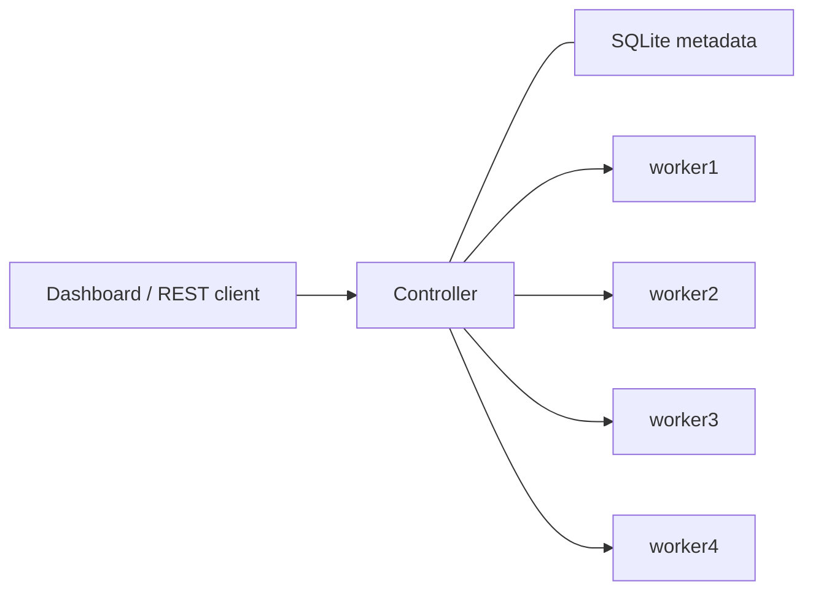

# Artaud

Artaud is a mini distributed object store for demonstrating replication and recovery. Upload a file, see which workers hold its chunks, and watch the controller restore redundancy when a worker goes offline. One FastAPI controller and four storage workers run locally in Docker Compose.

[Run locally](#run-locally) · [Demo](#demo-checklist) · [HTTP API](#http-api) · [Tests](#run-tests) · [Project report](docs/report/artaud-report.pdf)

## What it does

- Stores arbitrary files as ordered chunks of up to **1,000,000 bytes**, with two copies of each chunk on different workers.
- Verifies downloaded bytes with SHA-256. A surviving verified copy keeps its chunk readable and gives recovery a source.
- Provides six object API operations, persistent volumes, and a dashboard that shows placement and recovery.



## Run locally

Install Git and Docker Compose v2. On Windows or macOS, start Docker Desktop. Use Linux containers on Windows.

```sh
git clone https://github.com/KiritoReborn/mini-object-store.git
cd mini-object-store
docker compose up --build -d
docker compose ps
```

Open **Cluster** in the dashboard and wait for all four workers to show **Available**. A fresh base-mode checkout works without an owner key. If you already configured `ARTAUD_API_KEY`, unlock the dashboard using the connection steps below. [Local dashboard](http://127.0.0.1:8000/)

<details>
<summary>Update an existing checkout</summary>

```sh
git switch master
git pull --ff-only
```

From the directory that contains `compose.yaml`, rerun your original startup command with `--build`. Reuse the same Compose project name to keep its volumes and include the demo overlay if you used it before.

</details>


### View logs and stop

```sh
docker compose logs --tail 100 controller worker2
docker compose stop
```

`stop` retains containers and data. Use the same startup command to resume. `docker compose down -v` deletes the project's stored objects and metadata.

## Demo checklist

1. Upload a disposable file larger than 1,000,000 bytes. In **Cluster → Where each chunk lives**, select the file and check that each chunk has two healthy locations.
2. Download it. Use **Details → Verify integrity** to compare the downloaded file with the stored SHA-256. Change a custom metadata field and check that the update persists.
3. Find a chunk held by `worker2` and run `docker stop worker2`. The file should still download from its other copies. The default heartbeat timeout is 15 seconds from the last heartbeat, with a recovery pass roughly every five seconds. Watch `worker2` go **Offline** and wait for each chunk to have two available locations on surviving workers. Run `docker start worker2` and wait for it to go from **Joining** to **Available**. Any surplus is removed after two other copies are verified.
4. In a disposable upload, find a chunk with one healthy copy on `worker1` and a healthy counterpart on another worker. Copy its chunk ID from the metadata API, then change the bytes on the worker. This works in base mode.

   ```sh
   chunk_id=REPLACE_WITH_CHUNK_ID
   docker compose exec -T worker1 sh -c 'printf x >> "/data/chunks/$1"' artaud-demo "$chunk_id"
   ```

   Download and verify the file again. **Recent activity → Replicas & recovery** records the corruption and repair. If the healthy copy was read first, give the periodic inventory scan time to find the damaged one. With the overlay, **Corrupt this copy** injects a similar fault from the dashboard.
5. Delete the demo file and confirm it disappears from **Files**. The live test also checks cleanup on disk.

### Enable dashboard worker controls

The demo overlay adds **Start**, **Stop**, **Restart**, and **Corrupt this copy** to the dashboard. It uses the local Docker socket and requires a private owner key.

**Windows PowerShell**

```powershell
powershell -NoProfile -ExecutionPolicy Bypass -File .\scripts\Configure-Demo.ps1
notepad .env
```

**macOS or Linux**

The helper uses OpenSSL and preserves any existing owner-key entry.

```sh
sh scripts/configure-demo.sh
```

**Start or rebuild all five services with the overlay.**

```sh
docker compose -f compose.yaml -f compose.controls.yaml up --build -d
docker compose -f compose.yaml -f compose.controls.yaml ps
```

In **Connection settings**, leave **Backend HTTPS address** empty for the local controller. Paste the value of `ARTAUD_API_KEY` from `.env`, then select **Test connection** and **Connect backend**. A page reload clears the key.

The hosted frontend needs the controller PC, Docker, and the ngrok tunnel to be running. If the backend is offline, use the screenshot above and the recorded demo in the report. [Hosted dashboard](https://frontend-nine-iota-19.vercel.app/) · [Remote setup](docs/DEMO.md)

## HTTP API

The object API is served under `http://127.0.0.1:8000/api/v1/objects`. When an owner key is configured, send it in the `X-Artaud-Key` header. [OpenAPI reference](http://127.0.0.1:8000/docs) · [HTTP contract](contracts/api-contract.md)

| Method | Path | Operation | Success |
| --- | --- | --- | --- |
| `POST` | `/api/v1/objects` | Upload a file with optional custom metadata | `201` |
| `GET` | `/api/v1/objects` | List stored objects | `200` |
| `GET` | `/api/v1/objects/{id}` | Download the original bytes | `200` |
| `GET` | `/api/v1/objects/{id}/metadata` | Read metadata and the chunk manifest | `200` |
| `PATCH` | `/api/v1/objects/{id}/metadata` | Update custom metadata | `200` |
| `DELETE` | `/api/v1/objects/{id}` | Delete an object | `204` |

<details>
<summary>Run a complete upload, download, and delete with curl</summary>

Use a POSIX shell and a disposable file named `sample.bin`. Export `ARTAUD_API_KEY` in that shell if authentication is enabled. Replace `OBJECT_ID` with the ID from the upload response. `cmp` exits successfully when both files have identical bytes.

```sh
api=http://127.0.0.1:8000/api/v1/objects
curl -fsS -H "X-Artaud-Key: ${ARTAUD_API_KEY:-}" -F 'file=@sample.bin' \
  -F 'metadata={"demo":"yes"}' "$api"

object_id=OBJECT_ID
curl -fsS -H "X-Artaud-Key: ${ARTAUD_API_KEY:-}" "$api"
curl -fsS -H "X-Artaud-Key: ${ARTAUD_API_KEY:-}" "$api/$object_id/metadata"
curl -fsS -H "X-Artaud-Key: ${ARTAUD_API_KEY:-}" -X PATCH \
  -H 'Content-Type: application/json' -d '{"metadata":{"reviewed":true}}' \
  "$api/$object_id/metadata"
curl -fsS -H "X-Artaud-Key: ${ARTAUD_API_KEY:-}" -o retrieved.bin "$api/$object_id"
cmp sample.bin retrieved.bin
curl -fsS -H "X-Artaud-Key: ${ARTAUD_API_KEY:-}" -X DELETE "$api/$object_id"
```

</details>

The project plan proposed `client.cli` and `/admin/status`. The shipped interfaces are the dashboard, curl, `GET /api/v1/overview` for cluster status, and `GET /api/v1/objects/{id}/metadata` for chunk locations.

## Run tests

### Backend suite in one command

Run from the repository root with Docker running. The live acceptance test below runs separately.

**PowerShell**

```powershell
docker build -f Dockerfile.controller -t mini-object-store-controller:integration .; if ($LASTEXITCODE -eq 0) { docker run --rm --network none --mount "type=bind,source=$($PWD.Path),target=/review,readonly" --workdir /review mini-object-store-controller:integration python -B -m pytest tests -q -p no:cacheprovider --basetemp=/tmp/object-store-tests }
```

**macOS or Linux**

```sh
docker build -f Dockerfile.controller -t mini-object-store-controller:integration . && docker run --rm --network none --mount "type=bind,source=$PWD,target=/review,readonly" --workdir /review mini-object-store-controller:integration python -B -m pytest tests -q -p no:cacheprovider --basetemp=/tmp/object-store-tests
```

### Live five-container test

Use host Python 3.12 or newer. The test creates separate volumes and verifies recovery and a 50 MB round trip.

```sh
docker build -f Dockerfile.controller -t mini-object-store-controller:integration .
docker build -f Dockerfile.worker -t mini-object-store-worker:integration .
python tests/test_end_to_end.py --large
```

After installing Chromium below, add `--browser` to check the real dashboard against that same disposable cluster.

### Frontend tests and build

Use Node.js 22.12 or newer.

```sh
cd frontend
npm ci
npm test
npx playwright install chromium
npm run test:e2e
npm run build
```

Use `npm run dev` to start the Vite development server. `npm run build` regenerates `controller/static`. Rebuild the Docker controller to serve those assets. [Development guide](docs/DEVELOPMENT.md)

## Limits

The default chunk size is 1,000,000 bytes and the final chunk may be smaller. The controller and all four workers share one host. An object becomes unavailable if every verified copy of any of its chunks is unreachable. Repair needs a valid copy and an eligible worker.

## Documentation

| Topic | Where to look |
| --- | --- |
| Chunk placement, checksums, worker recovery, and failure limits | [Architecture](docs/ARCHITECTURE.md) |
| Local connection, worker, and download issues | [Troubleshooting](docs/TROUBLESHOOTING.md) |
| Local demo controls, Vercel, and the HTTPS tunnel | [Demo and deployment](docs/DEMO.md) |
| API and persistent metadata | [HTTP contract](contracts/api-contract.md) · [Database schema](contracts/db-schema.md) |
| Assignment and team plan | [Assignment brief](docs/Mini_Distributed_Cloud_Object_Store.pdf) · [Project plan](docs/Mini_Distributed_Object_Store_Final_Updated_Plan.pdf) |
| Project design, development challenges, screenshots, and verification | [PDF report](docs/report/artaud-report.pdf) · [LaTeX source](docs/report/artaud-report.tex) |

Build the report from its LaTeX source with Tectonic.

```sh
cd docs/report
tectonic artaud-report.tex
```

With TeX Live, run `pdflatex artaud-report.tex` twice from the same directory.
