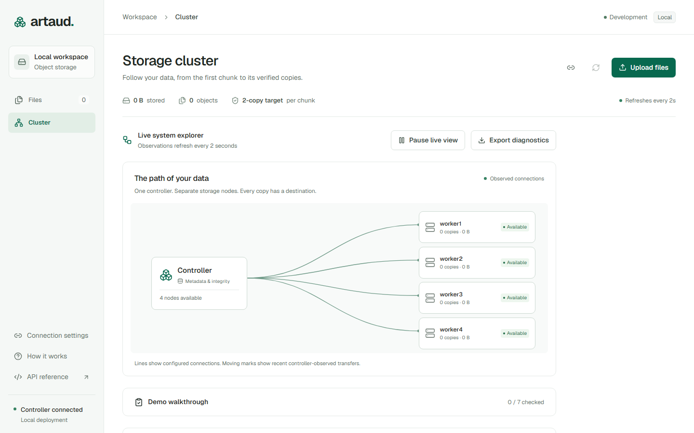
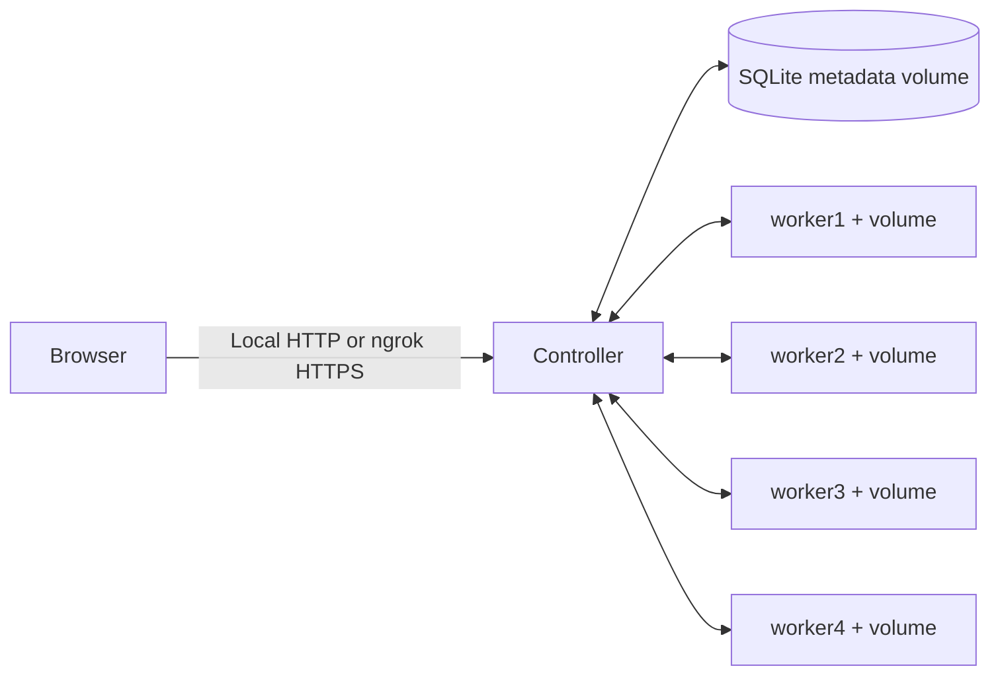

# Artaud — Distributed Object Store

Upload files, inspect their chunks, stop a worker and observe verified replica recovery. Artaud is a two-person distributed-systems project built with **Python, FastAPI, SQLite, React, TypeScript and Docker Compose**.

**[Live website](https://frontend-nine-iota-19.vercel.app/)** · [Setup](#setup-and-start) · [Architecture](docs/ARCHITECTURE.md) · [API](contracts/api-contract.md) · [Troubleshooting](docs/TROUBLESHOOTING.md)



_Actual dashboard capture; counts and availability are observations at capture time._

## What is included

- Six object APIs: multipart upload, download, list, metadata retrieval/update and deletion.
- Default **1,000,000-byte chunks**, with **two replicas on distinct workers** before an upload becomes READY.
- SHA-256 verification of chunks and complete objects, read fallback, heartbeat-based failure detection and automatic repair from a surviving good copy.
- Persistent SQLite metadata and a separate named Docker volume for each of four workers.
- A file workspace with upload queues, metadata search/editing, chunk inspection, exports, bulk deletion and local checksum verification.
- A cluster view with real topology, replica states, observed transfers, replay, activity and diagnostics.
- Optional owner-controlled worker Start/Stop/Restart and deliberate corruption of test replicas for demonstrations.

The local application runs completely in Docker. Vercel is an optional frontend host; the PC remains the backend. The public website requires a working HTTPS tunnel and the private owner key. Its frontend can load while the backend is offline or out of tunnel allowance.

## Setup and start

### 1. Requirements and checkout

Install **Git** and **Docker Desktop with Linux containers** (or Docker Engine with Compose v2+). Start Docker before running the project. Node.js is needed only for frontend development; host Python is needed only for the standalone integration test.

For a new checkout:

```sh
git clone https://github.com/KiritoReborn/mini-object-store.git
cd mini-object-store
```

For an existing checkout, from its repository root:

```sh
git switch master
git pull --ff-only
```

The default branch is `master`. If Git reports local edits or a conflict, resolve those before continuing.

> **Existing stored files:** keep the same Compose project name on every startup. `docker compose ls` shows existing projects. If you previously used a custom name, keep using `-p YOUR_EXISTING_PROJECT` on Compose commands. The default for a fresh `mini-object-store` folder is `mini-object-store`. Changing the project name selects different volumes.

### 2. Choose your startup mode

**Normal local use — Windows, macOS or Linux:**

```sh
docker compose -f compose.yaml up --build -d
docker compose -f compose.yaml ps
```

This starts the controller and all four workers. It serves the committed frontend build without a separate React/Node server. The optional owner key still applies if your existing `.env` contains one.

**Demo mode on Windows — worker buttons and corruption controls:**

Run in PowerShell from the repository root:

```powershell
powershell -NoProfile -ExecutionPolicy Bypass -File .\scripts\Configure-Demo.ps1 -FrontendOrigin "https://frontend-nine-iota-19.vercel.app"
powershell -NoProfile -ExecutionPolicy Bypass -File .\scripts\Start-Artaud.ps1 -DemoControls
```

The configuration helper preserves existing settings and creates a private owner key in the ignored `.env` if needed. The startup helper builds/starts all five services with the controls overlay. The process-scoped execution-policy flag applies only to these invocations.

**Demo mode on macOS/Linux:**

Generate an owner key locally:

```sh
openssl rand -hex 32
```

Copy the generated value into your existing or new root `.env`, preserving any other settings:

```dotenv
ARTAUD_API_KEY=PASTE_YOUR_GENERATED_KEY_HERE
ARTAUD_ALLOWED_ORIGINS=https://frontend-nine-iota-19.vercel.app
```

Then start every service with the overlay:

```sh
docker compose -f compose.yaml -f compose.controls.yaml up --build -d
```

The overlay gives the controller privileged Docker-socket access and enables deliberate fault injection. Use corruption controls only on files uploaded for the demo. The project-name allowlist follows the active Compose project; keep your existing project and volumes.

### 3. Open the dashboard and connect

Open **[http://127.0.0.1:8000/](http://127.0.0.1:8000/)**.

1. Choose **Connection settings**.
2. For the local dashboard, leave **Backend HTTPS address** empty to use the controller serving the page.
3. If an owner key is configured, enter only the value after `ARTAUD_API_KEY=` from the local `.env`.
4. Choose **Test connection → Connect backend**.
5. Open **Cluster** and wait for the workers to finish JOINING and become available. Nonempty uploads need at least two eligible workers.

On Windows, view the local key privately with `notepad .env`. The key clears on page reload and must be entered again. Keep it out of Git, screenshots and `VITE_` variables. API documentation is at **[http://127.0.0.1:8000/docs](http://127.0.0.1:8000/docs)**; a healthy `/health` response confirms the controller is up, not that every worker or replica is ready.

### 4. Check it works

Upload a disposable file larger than 1 MB. Inspect its ordered chunks and two recorded healthy locations, edit its metadata, then download and compare the checksum. **Details → Verify integrity** can compare a selected original/downloaded file with its stored SHA-256 locally in the browser (up to 128 MiB).

In demo mode, stop one actual holder, observe fallback/repair, then start it again. Starting a worker triggers inventory verification before admission. Recovery may delete surplus copies on rejoin, leaving a healthy returned worker empty.

**Corrupting both replicas of the same chunk removes its good source.** The affected download returns `503` until valid data is restored or re-uploaded. Two different worker buttons in one chunk row target two copies of that same chunk.

### 5. Stop and restart safely

Stop for the day while keeping containers and stored data:

```sh
docker compose -f compose.yaml stop
```

Next time, rerun the startup command for your chosen mode. Normal `docker compose -f compose.yaml down` also preserves named volumes. **Adding `-v` deletes volumes and their stored data.** Keep the same Compose project name when starting again.

## Connect the live Vercel website

Keep the local stack running. With the official ngrok agent configured on your PC, open a separate terminal:

```sh
ngrok http http://127.0.0.1:8000 --inspect=false
```

Reuse an existing agent if one already serves this controller. Copy its current **HTTPS Forwarding** origin, then open **[the live website](https://frontend-nine-iota-19.vercel.app/)**:

1. Open **Connection settings**.
2. Paste the ngrok origin into **Backend HTTPS address**, with no `/api` path.
3. Enter the same private owner key.
4. Choose **Test connection → Connect backend**.

Keep the PC, Docker and agent running. To save a default address for new visitors, update Vercel's production `VITE_API_BASE_URL` and redeploy. Existing tabs can retain an older address override. Never put the owner key in a frontend build variable.

The request path is **browser → ngrok HTTPS → PC controller → workers**. Vercel serves the interface; it does not run Docker or store the file bytes. If ngrok returns `ERR_NGROK_725`, its monthly account bandwidth is exhausted; restarting or redeploying does not reset the allowance. Use localhost while resolving it. See [the demo/deployment guide](docs/DEMO.md) for Vercel settings, exact-origin CORS and presentation steps.

## How storage works



Each chunk is placed on two distinct eligible workers, choosing the lowest healthy chunk count and breaking ties by worker ID. With four initially empty workers, sequential chunks commonly alternate worker1/2 and worker3/4. Counts can differ after failures or concurrent operations; balancing chunk counts does not guarantee equal byte usage.

The topology's **copies** count includes recorded HEALTHY replicas. **Replica records** in worker management includes every state, including CORRUPT, MISSING and pending cleanup. MISSING means an expected chunk is absent; CORRUPT means present bytes fail verification. Recovery can delete damaged bytes, after which the same record may become MISSING.

The controller verifies the whole object before starting a binary response. If both holders of a required chunk are unavailable and repair has not created another copy, that file cannot be downloaded. Four containers on one PC share one physical failure domain. See [architecture and failure limits](docs/ARCHITECTURE.md).

## API and development

| Method | Route                           | Success                                           |
| ------ | ------------------------------- | ------------------------------------------------- |
| POST   | `/api/v1/objects`               | 201 — multipart file and optional JSON metadata   |
| GET    | `/api/v1/objects/{id}`          | 200 — verified bytes; valid ranges can return 206 |
| GET    | `/api/v1/objects/{id}/metadata` | 200 — metadata, chunks and replica records        |
| PATCH  | `/api/v1/objects/{id}/metadata` | 200 — merge `{"metadata":{...}}`                  |
| DELETE | `/api/v1/objects/{id}`          | 204 — object hidden and copy deletion attempted   |
| GET    | `/api/v1/objects`               | 200 — READY objects                               |

When configured, `/api/v1/*` requests require `X-Artaud-Key`. Administrative mutations also require `X-Artaud-Admin: 1`. Offline physical deletion remains eventual. Complete request/error/range semantics are in the [HTTP contract](contracts/api-contract.md).

For frontend work, run `npm ci` and `npm run dev` inside `frontend`; run `npm run build` to regenerate `controller/static` before rebuilding the controller. Backend tests run in Linux Docker. [Development and testing](docs/DEVELOPMENT.md) contains the exact commands, module map and activity contract.

## Essential documentation

| Document                                                                         | Purpose                                                                   |
| -------------------------------------------------------------------------------- | ------------------------------------------------------------------------- |
| [Architecture](docs/ARCHITECTURE.md)                                             | Chunk placement, integrity, state meanings and failure model              |
| [Demo and deployment](docs/DEMO.md)                                              | Vercel/PC connection, worker controls and presentation                    |
| [Troubleshooting](docs/TROUBLESHOOTING.md)                                       | Owner key, JOINING, unknown containers, quotas and missing/corrupt copies |
| [Development and testing](docs/DEVELOPMENT.md)                                   | Controller/frontend development, automated checks and telemetry           |
| [HTTP contract](contracts/api-contract.md)                                       | Public/internal endpoints and shared wire behavior                        |
| [Database schema](contracts/db-schema.md) and [helpers](contracts/db-helpers.md) | Stable controller/recovery integration boundary                           |
| [Design system](DESIGN.md)                                                       | UI tokens, layout and interaction rules                                   |

Member A owns the controller/frontend; Member B owns worker storage and recovery. Contracts and acceptance checks are shared. All integrated work is on `master`.

## Limits

This is an educational system with a working local demo, not a production availability guarantee. It uses one controller/SQLite database, two replicas per chunk and one physical PC. It has no multi-user IAM, erasure coding, versioning, multi-region failover or S3-compatible protocol. Activity is bounded and process-local. A full-buffer browser fallback can make remote downloads appear to wait while bytes arrive. Containers run as root, and each worker volume requires one worker process.

Frontend and font notices are retained in [third-party notices](frontend/public/assets/third-party-notices.txt) and [the Geist license](frontend/public/assets/geist-license.txt).
