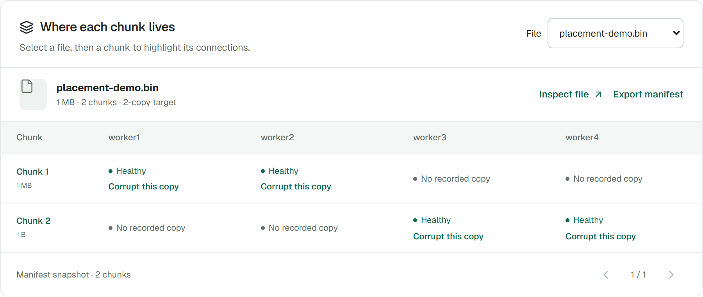
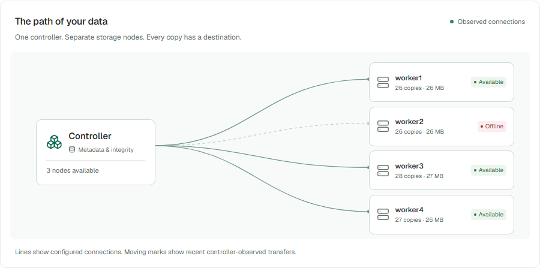
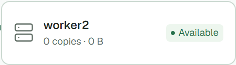
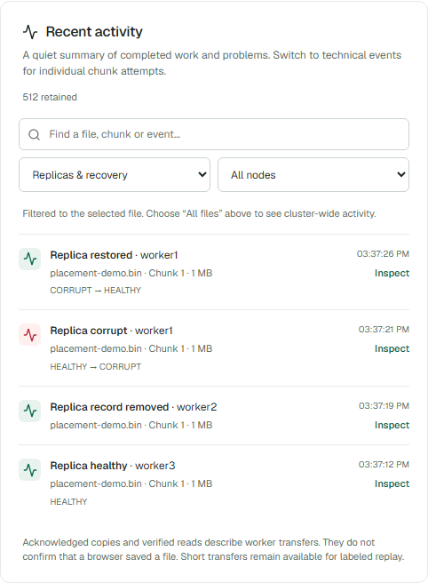
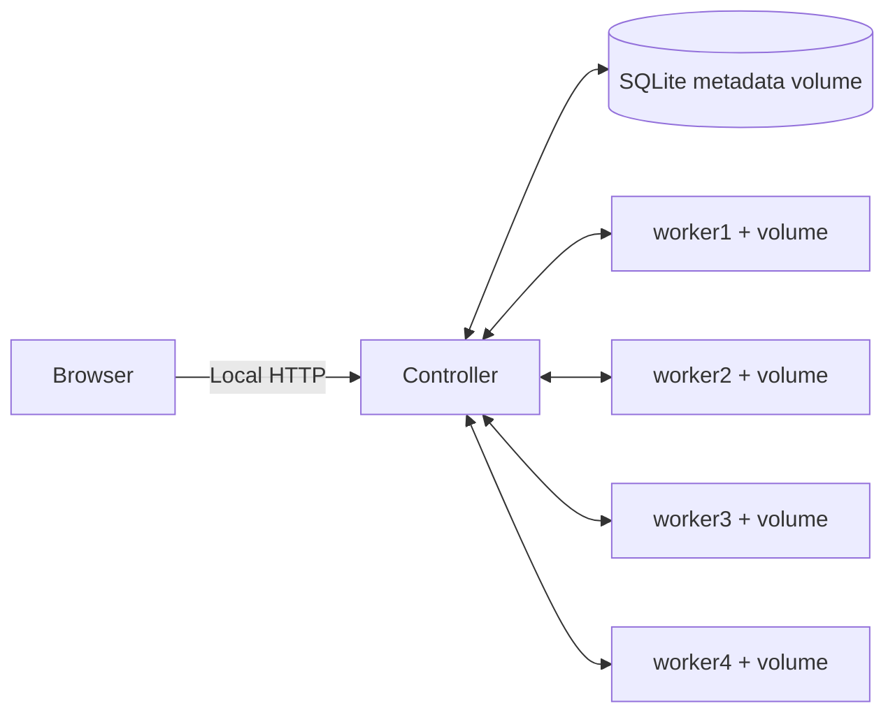

# Artaud — Distributed Object Store

Upload files, inspect their chunks, stop a worker and observe verified replica recovery. Artaud is a two-person distributed-systems project built with **Python, FastAPI, SQLite, React, TypeScript and Docker Compose**.

[Setup](#setup-and-start) · [Architecture](docs/ARCHITECTURE.md) · [API](contracts/api-contract.md) · [Troubleshooting](docs/TROUBLESHOOTING.md) · [Project report](docs/report/artaud-report.pdf)


_Captured during a local five-container demo._

## What is included

- Six object APIs for multipart upload, download, listing, metadata retrieval and updates, and deletion.
- Default **1,000,000-byte chunks**, with **two replicas on distinct workers** before an upload becomes READY.
- SHA-256 verification of chunks and complete objects, read fallback, heartbeat-based failure detection and automatic repair from a surviving good copy.
- Persistent SQLite metadata and a separate named Docker volume for each of four workers.
- A file workspace with upload queues, metadata search/editing, chunk inspection, exports, bulk deletion and local checksum verification.
- A cluster view with real topology, replica states, observed transfers, replay, activity and diagnostics.
- Optional owner-controlled worker Start/Stop/Restart and deliberate corruption of test replicas for demonstrations.

The controller serves the dashboard locally. Docker runs the controller and all four workers.

<a name="run-locally"></a>

## Setup and start

### 1. Requirements and checkout

Install **Git** and **Docker Desktop with Linux containers** (or Docker Engine with Compose v2+). Start Docker before running the project. Frontend development uses Node.js. The standalone integration test uses host Python.

Clone the repository for a new checkout.

```sh
git clone https://github.com/KiritoReborn/mini-object-store.git
cd mini-object-store
```

Update an existing checkout from its repository root.

```sh
git switch master
git pull --ff-only
```

The default branch is `master`. If Git reports local edits or a conflict, resolve those before continuing.

Run the commands below from the repository root (the folder containing `compose.yaml`). A normal `git clone` creates a folder named `mini-object-store`, so Docker Compose uses `mini-object-store` as its project name by default. If you downloaded a ZIP or renamed the folder, enter that folder and use the same commands. Compose derives the default project name from the directory.

**Existing installations only:** If you previously started the stack with an explicit project name, keep using it to reuse the same volumes. For example, if your existing project is `cloud_project`, add `-p cloud_project` immediately after `docker compose` in each command. A fresh checkout needs no `-p` flag.

### 2. Start the stack

**For evaluation with dashboard controls, configure the owner key before starting Docker Compose.** Use a plain-text file named `.env` beside `compose.yaml`. Keep an existing `ARTAUD_API_KEY` if it is at least 32 characters long. The base configuration works without an owner key on a fresh checkout.

**macOS/Linux**

From the repository root, run the setup helper, then open `.env` to find the key.

```sh
sh scripts/configure-demo.sh
nano .env
```

**Windows (PowerShell)**

Run the Windows helper from the repository root.

```powershell
powershell -NoProfile -ExecutionPolicy Bypass -File .\scripts\Configure-Demo.ps1
notepad .env
```

The helper creates the file and generates a key if none is configured. In Notepad, find the `ARTAUD_API_KEY=` line for the dashboard step below. Running the helper without `-FrontendOrigin` preserves existing allowed origins. Supplying that argument replaces the allowed-origins setting.

The helper saves the key in this format. The placeholder represents your generated value.

```dotenv
ARTAUD_API_KEY=<your-generated-key>
```

The local dashboard uses the same origin as the controller, so you can leave `ARTAUD_ALLOWED_ORIGINS` unset. The controls overlay supplies the worker and controller feature flags.

Start or upgrade the **entire stack** with the controls overlay. This enables **Start**, **Stop**, and **Restart** for the four workers and **Corrupt this copy** for eligible replicas. The overlay mounts the Docker socket into the controller and enables fault injection on the workers.

```sh
docker compose -f compose.yaml -f compose.controls.yaml up --build -d
docker compose -f compose.yaml -f compose.controls.yaml ps
```

**Standard dashboard.** Use the base configuration to run the controller and four workers with storage and recovery.

```sh
docker compose -f compose.yaml up --build -d
```

**Container controls only.** On an already running base stack, this command enables the controller’s Docker Start/Stop/Restart actions. The four workers keep their base configuration. Use the full demo command above for **Corrupt this copy**.

```sh
docker compose -f compose.yaml -f compose.controls.yaml up -d --no-deps controller
```

### 3. Open the dashboard and connect

Open **[http://127.0.0.1:8000/](http://127.0.0.1:8000/)**.

1. Choose **Connection settings**.
2. For the local dashboard, leave **Backend HTTPS address** empty to use the controller serving the page.
3. For the full demo, open the root `.env` with `nano .env` (macOS/Linux) or `notepad .env` (Windows). Copy **only the value after the first `=`** on the `ARTAUD_API_KEY=` line into **Owner access key**. Include any trailing `=` characters in the value. For the base stack with no key configured, leave this field empty.
4. Choose **Test connection → Connect backend**.
5. Open **Cluster → Manage workers** to see the worker controls. Wait for the workers to finish JOINING and become available. Nonempty uploads need at least two eligible workers.

The dashboard clears the key on page reload. If you change the key in `.env` after startup, rerun the full demo Compose command from step 2 to apply it, then enter the new value in **Connection settings**. Keep it out of Git, screenshots and `VITE_` variables. API documentation is at **[http://127.0.0.1:8000/docs](http://127.0.0.1:8000/docs)**. Use `/health` to check the controller and **Cluster** to check worker and replica readiness.

<a name="demo-checklist"></a>

### 4. Check it works

Upload a disposable file larger than 1 MB. Inspect its ordered chunks and two recorded healthy locations, edit its metadata, then download and compare the checksum. **Details → Verify integrity** can compare a selected original/downloaded file with its stored SHA-256 locally in the browser (up to 128 MiB).



_The 1,000,001-byte demo object spans two chunks. The placement table shows both recorded copies of each chunk._

In demo mode, stop a worker that holds a copy, observe fallback and repair, then start it again. For example, find a chunk held by `worker2`, run `docker stop worker2`, and download the file again. Wait for two available copies before running `docker start worker2`.

Availability reflects verified admission and heartbeat. The default heartbeat timeout is 15 seconds, and recovery runs about every 5 seconds. Starting a worker triggers inventory verification before it can rejoin. A healthy returned worker can show zero copies after recovery removes surplus copies.

| Worker2 offline | Worker2 readmitted |
| --- | --- |
|  |  |

On a disposable upload, use **Corrupt this copy** on a replica with a healthy counterpart. Downloads verify the copies they read. Allow up to about 60 seconds for the next scheduled inventory scan if the download reads the healthy copy first. Open **Recent activity** and select **All technical events** to see fault injection, detection and repair.



Corrupting both replicas of the same chunk removes its good source. The affected download returns `503 OBJECT_UNAVAILABLE` until a valid copy of that chunk is restored. Uploading the original file again creates a new object ID. Two worker buttons in one chunk row target two copies of that same chunk.

<details>
<summary>Inject a fault from the terminal</summary>

Use a POSIX shell with curl and jq. On Windows, use Git Bash, WSL or the dashboard controls. The first chunk appears as **Chunk 1** in the cluster view and has index `0` in the API. Set the object ID below. If owner access is enabled, export `ARTAUD_API_KEY` in the shell first. The filter selects the chunk only if it has two available locations, including `worker1`.

```sh
object_id=REPLACE_WITH_OBJECT_ID
chunk_id=$(
  curl -fsS -H "X-Artaud-Key: ${ARTAUD_API_KEY:-}" \
    "http://127.0.0.1:8000/api/v1/objects/$object_id/metadata" |
    jq -er '
      .chunks[]
      | select(.index == 0 and (.available_workers | length) == 2)
      | select((.available_workers | index("worker1")) != null)
      | .chunk_id
    '
) &&
  docker compose exec -T worker1 sh -c 'printf x >> "/data/chunks/$1"' artaud-demo "$chunk_id"
```

</details>

Delete the disposable object when the demo is complete.

### 5. Stop and restart safely

Stop the stack while keeping containers and stored data.

```sh
docker compose -f compose.yaml stop
```

Next time, rerun the startup command for your chosen mode. Normal `docker compose -f compose.yaml down` also preserves named volumes. **Adding `-v` deletes volumes and their stored data.** Keep the same Compose project name when starting again.

## How storage works



Each chunk is placed on two distinct eligible workers, choosing the lowest healthy chunk count and breaking ties by worker ID. With four initially empty workers, sequential chunks commonly alternate worker1/2 and worker3/4. Counts can differ after failures or concurrent operations. Evenly placed chunks can still occupy different amounts of disk space.

The topology's **copies** count includes recorded HEALTHY replicas. **Replica records** in worker management counts every state, including CORRUPT, MISSING and pending cleanup. MISSING means an expected chunk is absent. CORRUPT means present bytes fail verification. Recovery can delete damaged bytes, after which the same record may become MISSING.

The controller verifies the whole object before starting a binary response. If both holders of a required chunk are unavailable and repair has not created another copy, that file cannot be downloaded. Four containers on one PC share one physical failure domain. See [architecture and failure limits](docs/ARCHITECTURE.md).

<a name="http-api"></a>

## API and development

| Method | Route | Success |
| --- | --- | --- |
| POST | `/api/v1/objects` | 201 · Multipart file and optional JSON metadata |
| GET | `/api/v1/objects/{id}` | 200 · Verified bytes (206 for valid ranges) |
| GET | `/api/v1/objects/{id}/metadata` | 200 · Metadata, chunks and replica records |
| PATCH | `/api/v1/objects/{id}/metadata` | 200 · Merge `{"metadata":{...}}` |
| DELETE | `/api/v1/objects/{id}` | 204 · Object hidden and copy deletion attempted |
| GET | `/api/v1/objects` | 200 · READY objects |

When configured, `/api/v1/*` requests require `X-Artaud-Key`. Administrative mutations also require `X-Artaud-Admin: 1`. Offline physical deletion remains eventual. Complete request/error/range semantics are in the [HTTP contract](contracts/api-contract.md).

For frontend work, use Node.js 22.12 or newer. Run `npm ci` and `npm run dev` inside `frontend`. Run `npm run build` to regenerate `controller/static` before rebuilding the controller. Backend tests run in Linux Docker. [Development and testing](docs/DEVELOPMENT.md) contains the exact commands, module map and activity contract.

### Run tests

<details>
<summary>Backend suite in one command</summary>

Run from the repository root with Docker running.

**PowerShell**

```powershell
docker build -f Dockerfile.controller -t mini-object-store-controller:integration .; if ($LASTEXITCODE -eq 0) { docker run --rm --network none --mount "type=bind,source=$($PWD.Path),target=/review,readonly" --workdir /review mini-object-store-controller:integration python -B -m pytest tests -q -p no:cacheprovider --basetemp=/tmp/object-store-tests }
```

**macOS or Linux**

```sh
docker build -f Dockerfile.controller -t mini-object-store-controller:integration . && docker run --rm --network none --mount "type=bind,source=$PWD,target=/review,readonly" --workdir /review mini-object-store-controller:integration python -B -m pytest tests -q -p no:cacheprovider --basetemp=/tmp/object-store-tests
```

</details>

For the live five-container test, frontend unit tests and Chromium tests, see the [development guide](docs/DEVELOPMENT.md).

## Essential documentation

| Document | Purpose |
| --- | --- |
| [Architecture](docs/ARCHITECTURE.md) | Chunk placement, integrity, state meanings and failure model |
| [Demo and deployment](docs/DEMO.md) | Local setup, worker controls and presentation |
| [Troubleshooting](docs/TROUBLESHOOTING.md) | Owner key, JOINING, unknown containers, quotas and missing/corrupt copies |
| [Development and testing](docs/DEVELOPMENT.md) | Controller/frontend development, automated checks and telemetry |
| [HTTP contract](contracts/api-contract.md) | Public/internal endpoints and shared wire behavior |
| [Database schema](contracts/db-schema.md) and [helpers](contracts/db-helpers.md) | Stable controller/recovery integration boundary |
| [Design system](DESIGN.md) | UI tokens, layout and interaction rules |
| [Project report](docs/report/artaud-report.pdf) and [LaTeX source](docs/report/artaud-report.tex) | Architecture, the live demonstration, timings and verification |
| [Assignment brief](docs/Mini_Distributed_Cloud_Object_Store.pdf) and [project plan](docs/Mini_Distributed_Object_Store_Final_Updated_Plan.pdf) | Requirements and implementation plan |

Jaya Raghunandhan Reddy P developed the controller and dashboard. Varanasi Harshith Raj developed worker storage and recovery. Contracts and acceptance checks are shared. All integrated work is on `master`.

The hosted frontend needs the controller PC, Docker and the ngrok tunnel running. [Hosted dashboard](https://frontend-nine-iota-19.vercel.app/) · [Remote setup](docs/DEMO.md)

## Limits

Artaud is an educational system designed for a local demo. It uses one controller/SQLite database, two replicas per chunk and one physical PC. The local REST API uses a single owner key when authentication is enabled. Activity is bounded and process-local. A full-buffer browser fallback can make remote downloads appear to wait while bytes arrive. Containers run as root, and each worker volume requires one worker process.

## License

Artaud is released under the [MIT License](LICENSE). The bundled Geist font uses the [SIL Open Font License 1.1](frontend/public/assets/geist-license.txt). [Third-party notices](frontend/public/assets/third-party-notices.txt)
