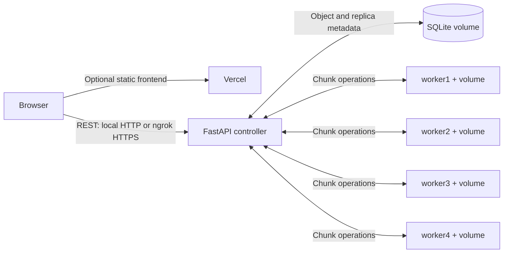

# Artaud

### Mini Distributed Cloud Object Store

A working object store that makes distributed storage visible: upload a file, inspect its chunks and replicas, stop a worker, and watch the cluster restore redundancy.

Built with **Python · FastAPI · SQLite · React · TypeScript · Docker Compose**. One controller coordinates four workers, with two copies of each chunk on distinct workers and SHA-256 verification against authoritative metadata.

**[Open the live dashboard](https://frontend-nine-iota-19.vercel.app/)** · [Quick start](#quick-start) · [Architecture](docs/ARCHITECTURE.md) · [API reference](contracts/api-contract.md) · [Documentation](docs/README.md)

> **Live demo access:** the frontend is hosted on Vercel; the controller and workers run on the owner's PC through an HTTPS tunnel. The PC, Docker and tunnel must be running. Open **Connection settings**, enter the private owner key, then choose **Test connection → Connect backend**. The key clears on reload. Visitors need a key from the demo owner; it is intentionally absent from this repository.


_Real dashboard capture. Node status, file counts and placement reflect the connected cluster at capture time._

## What it does

| Area                     | Implemented behavior                                                                                                                                        |
| ------------------------ | ----------------------------------------------------------------------------------------------------------------------------------------------------------- |
| Object lifecycle         | Multipart upload, verified download, metadata retrieval/editing, listing and deletion through six independent REST endpoints.                               |
| Chunking and replication | Default 1,000,000-byte chunks; two acknowledged copies on distinct eligible workers before publishing an object. Empty files are supported.                 |
| Placement                | Selects workers with the fewest healthy chunk records, using worker ID to break ties. Retries another worker after a failed write.                          |
| Integrity                | Per-chunk and whole-object SHA-256 in SQLite; download fallback rejects missing, corrupt or incorrectly hashed copies.                                      |
| Recovery                 | Heartbeats, failure detection, verified worker admission, replica repair, rejoin reconciliation and orphan/surplus cleanup.                                 |
| File workspace           | Upload queue, cancellation, metadata search, sorting/filtering, chunk inspector, listing exports and confirmed bulk deletion.                               |
| Cluster explorer         | Controller-to-worker topology, observed transfers/replay, chunk placement, replication status, quiet activity summaries and diagnostic exports.             |
| Worker management        | Labels, notes, upload-placement pause and connection of existing supported workers. Optional authenticated Start/Stop/Restart for the four demo containers. |
| Persistence              | SQLite metadata and each worker's chunk files live in separate named Docker volumes.                                                                        |

## Quick start

### Requirements

- Git and access to this GitHub repository.
- Docker Engine with Compose v2+, or Docker Desktop running **Linux containers**.
- Node.js is needed only to edit/rebuild the frontend. Python on the host is needed only for the standalone acceptance script.

```sh
git clone https://github.com/KiritoReborn/mini-object-store.git
cd mini-object-store
docker compose up --build -d
docker compose ps
```

Open **[http://127.0.0.1:8000/](http://127.0.0.1:8000/)**. The controller serves the committed frontend build, so a separate frontend server is unnecessary. Interactive API docs are at [http://127.0.0.1:8000/docs](http://127.0.0.1:8000/docs).

Workers initially show `JOINING`. Recovery checks their inventory and bytes before admitting them as `ALIVE`. Nonempty uploads require at least two eligible workers. A successful `/health` response alone does not prove that storage is ready.

A clean local checkout has no owner key configured. If your existing `.env` defines `ARTAUD_API_KEY`, enter that key in Connection settings for local access too. See [troubleshooting](docs/TROUBLESHOOTING.md) for access or admission errors.

### Windows helper and optional worker controls

From the repository root in PowerShell:

```powershell
.\scripts\Configure-Demo.ps1
.\scripts\Start-Artaud.ps1 -DemoControls
```

The first command creates a private owner key in the ignored `.env`, preserving existing settings. The second builds/starts the stack with optional Docker controls. Enter the value of `ARTAUD_API_KEY` in the dashboard; do not publish it or put it in a frontend build variable.

The controls overlay mounts the Docker socket, which is privileged access. It permits only Start/Stop/Restart of the four identified project workers. Without the overlay, normal file operations and recovery still work. See the [demo and HTTPS setup guide](docs/DEMO.md).

### Stop without removing stored data

```sh
docker compose down
```

Named volumes survive normal Stop/Start and Compose shutdown. Keep the same Compose project name when starting again. **`docker compose down -v` deletes the project's stored volumes.** Application-driven recovery can still remove obsolete chunks from a persistent volume; persistence does not prevent intentional cleanup. [Docker volume lifecycle](https://docs.docker.com/engine/storage/volumes/#a-volumes-lifecycle)

## Architecture



The controller owns object metadata, placement, verification and API responses. Workers store chunks and local checksum sidecars. Recovery coordinates repair through the controller; workers do not form a forwarding chain. Vercel serves frontend files while the browser sends API requests directly to the PC.

### How chunks are distributed

A copy is one replica of one chunk, not a copy of the whole file. Starting with four empty, healthy workers and a single upload:

| Chunk | Storage locations |
| ----- | ----------------- |
| 1     | worker1 + worker2 |
| 2     | worker3 + worker4 |
| 3     | worker1 + worker2 |
| 4     | worker3 + worker4 |

This gives each worker two stored chunks. Placement balances **healthy chunk counts**, not disk capacity or exact byte totals. Existing data, concurrent uploads, paused placement and failures can change the pattern. It is deterministic least-loaded selection, not consistent hashing.

### What happens when workers fail?

- **One holder fails:** downloads can use the other verified copy; recovery creates a replacement on an eligible worker.
- **Both holders of a required chunk fail before repair:** that file's download returns JSON `503`; the controller does not send a partially reconstructed file. Restarting a holder can restore access if its persistent bytes remain intact.
- **Every copy is permanently destroyed:** replication alone cannot reconstruct the missing bytes. This release has no erasure coding or backup-restore API.
- **A worker returns empty:** recovery may have verified two copies elsewhere and deleted its surplus third copies. This is normal rejoin cleanup, not Docker volume loss. Existing healthy replicas are not automatically rebalanced back onto it.

All five containers run on one PC. They demonstrate process failures, not independent machine or availability-zone failures. The [architecture guide](docs/ARCHITECTURE.md) explains the lifecycle, failure matrix and differences from AWS, Azure and Google Cloud storage.

## REST API

Base URL for local use: `http://127.0.0.1:8000`.

| Method   | Endpoint                        | Success                                                         |
| -------- | ------------------------------- | --------------------------------------------------------------- |
| `POST`   | `/api/v1/objects`               | `201` — upload multipart `file`, optional JSON `metadata` field |
| `GET`    | `/api/v1/objects/{id}`          | `200` — original verified bytes                                 |
| `GET`    | `/api/v1/objects/{id}/metadata` | `200` — metadata, ordered chunks and replica records            |
| `PATCH`  | `/api/v1/objects/{id}/metadata` | `200` — merge custom metadata                                   |
| `DELETE` | `/api/v1/objects/{id}`          | `204` — logical deletion and reachable-copy cleanup             |
| `GET`    | `/api/v1/objects`               | `200` — READY objects                                           |

Example against a clean local profile, using an existing `sample.bin`:

```sh
curl --fail-with-body -F 'file=@sample.bin' \
  -F 'metadata={"project":"artaud"}' \
  http://127.0.0.1:8000/api/v1/objects

curl --fail-with-body http://127.0.0.1:8000/api/v1/objects
```

The example uses POSIX shell quoting. In Windows PowerShell use `curl.exe`; see the [controller guide](docs/CONTROLLER.md) for a native example. When an owner key is configured, API calls require `X-Artaud-Key`. Administrative mutations also require `X-Artaud-Admin: 1`; the frontend supplies it after explicit user confirmation.

Errors use `{"error":"CODE","message":"description"}`. Invalid input returns `400`, unknown objects `404`, conflicts `409`, unexpected faults `500` and unavailable required storage `503`. Optional access/origin checks also return `401`/`403`. PATCH accepts `{"metadata":{...}}`; system fields cannot be overwritten, omitted keys are preserved, and `null` is a stored value rather than deletion.

See the [complete HTTP contract](contracts/api-contract.md) for worker routes, metadata limits, extensions and deletion semantics.

## Verification

Verified on **14 November 2026** against the integrated application source:

| Check                          | Result                                                                                                                                  |
| ------------------------------ | --------------------------------------------------------------------------------------------------------------------------------------- |
| Linux backend suite            | 299 passed; 1 explicitly skipped live check; 1 framework deprecation warning                                                            |
| Frontend unit tests            | 28 passed                                                                                                                               |
| Chromium UI tests              | 29 passed, including accessibility and narrow layouts                                                                                   |
| Real five-container acceptance | Admission, physical replication, worker failure/repair/rejoin, forged-sidecar corruption repair, restart persistence and cleanup passed |
| Large transfer                 | 50,000,000 bytes / 50 chunks, streamed upload/download with matching SHA-256                                                            |
| Public demo                    | Vercel → HTTPS → PC upload, metadata, chunks, verified download and deletion passed                                                     |

Run the isolated live acceptance check after building both images:

```sh
docker build -f Dockerfile.controller -t mini-object-store-controller:integration .
docker build -f Dockerfile.worker -t mini-object-store-worker:integration .
python tests/test_end_to_end.py --large
```

It creates its own labelled five-container stack and volumes, uses the actual reconciler and removes its own resources. It does not stop the normal stack or manually grant workers `ALIVE`. For backend unit commands, frontend checks and the optional `--browser` workflow, see [acceptance and testing](docs/ACCEPTANCE.md).

## Project structure

```text
controller/       FastAPI, SQLite, placement, object lifecycle, recovery, telemetry
  static/         Committed production frontend build
worker/           Chunk storage, sidecars, internal HTTP API, heartbeat
frontend/         React/TypeScript source, design styles and browser tests
contracts/        HTTP, database schema and stable helper contracts
tests/            Backend tests and isolated live acceptance harness
scripts/          Windows setup/start helpers and POSIX demo wrapper
docs/             Architecture, operation, testing and continuation guides
compose.yaml      Controller + four workers with independent named volumes
```

## Documentation and development

Start with the [documentation index](docs/README.md). Main guides:

- [Architecture and failure model](docs/ARCHITECTURE.md)
- [Local/public demo and worker controls](docs/DEMO.md)
- [Troubleshooting](docs/TROUBLESHOOTING.md)
- [Controller development](docs/CONTROLLER.md) and [frontend development](docs/FRONTEND.md)
- [Live topology and event semantics](docs/LIVE_SYSTEM.md)
- [Acceptance evidence and repeatable tests](docs/ACCEPTANCE.md)
- [Shared HTTP contract](contracts/api-contract.md), [schema](contracts/db-schema.md) and [database helpers](contracts/db-helpers.md)
- [Current handoff for Codex, Claude or a new contributor](docs/HANDOFF.md)

Member A owns the controller/API/database and frontend; Member B owns worker storage and recovery. Contracts and acceptance checks are shared. The default branch is **`master`**, and all integrated work lives there; continue on that branch under the current project workflow. Read `AGENTS.md` and the handoff before changing shared boundaries.

## Scope and limitations

This is an educational distributed-systems project with a working demo. The single controller, SQLite database and physical PC remain failure points. Replication is fixed at two; reads verify bytes, while the dashboard is an observation of recorded state rather than a continuous full-disk audit. Activity is bounded and process-local, and detailed repair-transfer animation requires explicit recovery events.

There is no S3-compatible protocol, multi-user IAM, versioning, erasure coding, resumable upload, multi-region failover or production availability SLA. Containers currently run as root, each worker volume requires a single worker process, and the Python dependency set includes test tools with some unpinned transitive dependencies. Worker chunk/sidecar commits can be interrupted between files; verified reads reject inconsistent pairs and recovery can repair them from a good copy.

Third-party frontend/font notices ship in [the public assets](frontend/public/assets/third-party-notices.txt) and [Geist license](frontend/public/assets/geist-license.txt).
